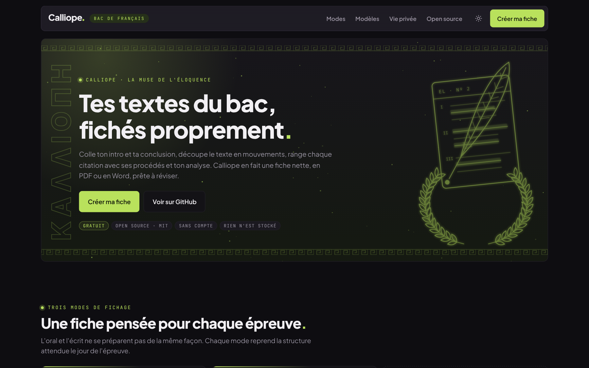
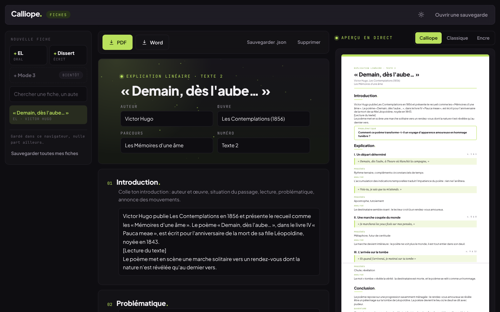

<p align="center">
  <picture>
    <source media="(prefers-color-scheme: light)" srcset="public/img/logo-light.svg">
    
  </picture>
</p>

<p align="center">
  <b>ΚΑΛΛΙΟΠΗ · la muse de l'éloquence</b><br>
  Prépare tes textes du bac de français pour l'oral et l'écrit. Organise tes idées, vérifie le rendu de ta fiche et télécharge-la en PDF ou en Word. Sans inscription : tes textes restent dans ton navigateur.
</p>

<p align="center">
  
  
  
  
</p>

---

<p align="center">
  <picture>
    <source media="(prefers-color-scheme: light)" srcset="docs/screenshots/site-light.png">
    
  </picture>
</p>

## Ce qu'elle fait

| | |
|---|---|
| **Explication linéaire** | Pour l'oral : intro et conclusion à coller, problématique, mouvements numérotés avec leurs lignes, et pour chaque citation ses procédés et ton analyse. Question de grammaire incluse. |
| **Dissertation** | Pour l'œuvre intégrale : photo du livre, auteur, date, genre, mouvement, parcours, biographie, contexte, résumé, thèmes, citations clés et sujets avec leurs plans. |
| **Troisième mode** | En préparation. Les idées sont les bienvenues dans les [issues](https://github.com/SalksCore/calliope/issues). |
| **Aperçu en direct** | La fiche se recompose à chaque frappe dans le modèle choisi, aux mêmes mesures que le PDF. |
| **Export PDF et Word** | Trois modèles : *Calliope* (les couleurs du projet), *Classique* (serif, sobre) et *Encre* (compact, noir et blanc). Accents, « guillemets » et espaces insécables respectés. |
| **Tes données restent sur ton appareil** | Pas de compte ni de base de données. Les fiches restent dans ton navigateur et peuvent être sauvegardées dans un fichier `.json` pour être rouvertes quand tu veux. |
| **Clair ou sombre** | Le thème suit celui de ton appareil, et se change d'un clic. |

<p align="center">
  <picture>
    <source media="(prefers-color-scheme: light)" srcset="docs/screenshots/editeur-light.png">
    
  </picture>
</p>

## Lancer le projet

Il faut **Node.js 20.9 ou plus récent**.

```bash
git clone https://github.com/SalksCore/calliope.git
cd calliope
npm install
npm run dev        # http://localhost:3000
```

`npm run build` produit un site **100 % statique** dans `out/`, à poser sur n'importe quel hébergeur de fichiers.

## Mettre en ligne

Le site officiel tourne sur **Cloudflare Pages** : commande de build `npm run build`, dossier de sortie `out`. N'importe quel hébergeur de fichiers statiques fait l'affaire.

Le pied de page et les pages légales viennent du kit commun aux sites Salks. (`src/components/salks`). Si tu héberges ta propre copie, remplace-les par les tiens.

## Sous le capot

| Dossier | Rôle |
|---|---|
| `src/app/` | Les pages : accueil, `/fiches`, `/legal`, et les styles (`globals.css`) |
| `src/components/` | Barre du haut, footer, couche panthéon, aperçu des modèles |
| `src/components/editor/` | L'éditeur : formulaires EL et Dissert, liste des fiches, exports |
| `src/lib/blocks.ts` | Met une fiche à plat : l'aperçu, le PDF et le Word lisent tous les trois ces blocs |
| `src/lib/templates.ts` | Les trois modèles d'export |
| `src/lib/pdf.ts`, `src/lib/docx.ts` | Les exports, avec [jsPDF](https://github.com/parallax/jsPDF) et [docx](https://github.com/dolanmiu/docx), chargés seulement au clic |

Next.js 16 (App Router, export statique), React 19, TypeScript. Polices Plus Jakarta Sans, JetBrains Mono et Source Serif 4 hébergées dans le dépôt : aucun appel à un service tiers.

## Contribuer

Tout est expliqué dans [CONTRIBUTING.md](CONTRIBUTING.md), y compris comment ajouter un mode de fichage.

## Licence

[MIT](LICENSE). Polices sous SIL Open Font License 1.1, voir [src/fonts/LICENSE.md](src/fonts/LICENSE.md).

<p align="center">
  <a href="https://github.com/SalksCore">
    <picture>
      <source media="(prefers-color-scheme: light)" srcset="public/img/salks-logo-light.svg">
      
    </picture>
  </a><br>
  <sub>Calliope est géré et maintenu par Salks.</sub>
</p>
